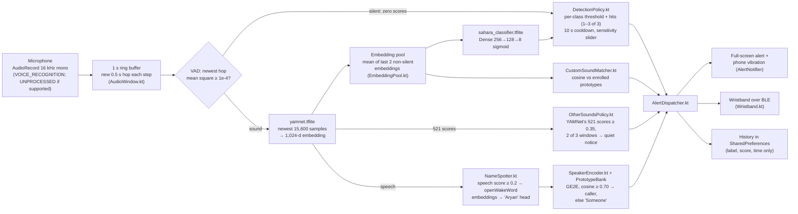
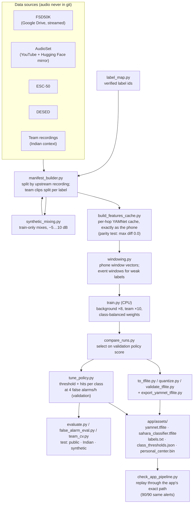
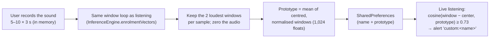

# SAHARA architecture

SAHARA has three parts that share a few fixed contracts: the **ML pipeline** (Python, offline, on a Mac), the
**phone app** (Flutter UI + native Kotlin service, Android), and the **wristband** (ESP32 firmware). Everything that
touches sound runs on the phone; nothing is uploaded, and the release app has no internet permission.

## 1. On the phone: from microphone to alert

- **Foreground service** (`AudioCaptureService.kt`): keeps capturing with the screen off and after the app is swiped
  from recents, with a persistent notification. All detection runs in Kotlin; the Flutter UI only displays state and
  settings over the platform channel (`SaharaChannel.kt` ↔ `lib/audio/sahara_service.dart`), so detection works with
  no Dart isolate alive.
- **Audio is never stored.** The ring buffer is overwritten every 0.5 s; enrolment samples are zeroed right after use.
  App storage holds only settings, alert history and custom-sound prototypes (checked on the phone, see
  `docs/evaluation_report.md`).
- **Cost** on a Galaxy S24: 20–29 ms per window with the screen on, 47–49 ms with it off (budget: 500 ms).

## 2. Offline: training and export

One command reproduces it: `python scripts/run_full_pipeline.py` (data → synthetic → features → train → eval →
export → report); `docs/evaluation_report.md` is generated from the selected run's files.

## 3. Personalization: enrolling a custom sound

## 4. Name calls and caller ID

A separate speech path, used only when YAMNet's speech score is at least 0.2: openWakeWord's melspectrogram and
embedding models (pretrained) turn the last 2 s into speech embeddings, and a small logistic head scores the
name "Aryan" for any voice. When it fires, a pretrained GE2E speaker encoder (Resemblyzer weights, run in plain Kotlin)
compares the voice with the callers the family enrolled (a few taps of them saying the name); a match at cosine ≥ 0.70
names the caller, otherwise the alert says "Someone". The alert goes to the screen, vibration and the wristband
(BLE id 0x20, its own pattern). Results: `docs/name_call_eval.md`; design: `docs/name_call.md`.

## 5. Custom sounds: evaluation

Evaluated in `src/personalization/` (see the report): it separates distinctive household sounds from background, but
cannot tell names apart, so the app offers it as experimental and for household sounds only. On the wristband a custom
sound uses the doorbell pattern; BLE protocol v1 has no custom-sound id.

## Contracts shared across the three parts

| Contract | Value | Defined in | Mirrored in |
|---|---|---|---|
| Class order | `smoke_alarm, doorbell, siren, knocking, dog_bark, baby_cry, glass_break, appliance_beep` | `SOUND_CLASSES`, `src/config.py` | `app/assets/labels.txt` (generated), `firmware/.../sound_classes.h` (build-checked) |
| Audio input | 16 kHz mono, YAMNet patch 15,600 samples (0.975 s), 0.96 s frames / 0.48 s hop inside YAMNet | `src/config.py` | `ModelConfig.kt` |
| Inference cadence | 1 s buffer, 0.5 s hop, VAD 1e-4 on the newest hop, mean of last 2 non-silent embeddings | `src/config.py`, `windowing.py` | `ModelConfig.kt`, `AudioWindow.kt`, `EmbeddingPool.kt` |
| Alert policy | threshold + hits (1–3 of 3) per class, 10 s cooldown, sensitivity ±2 log-odds | `class_thresholds.json`, `src/evaluation/policy.py` | `DetectionPolicy.kt` (shared fixture test) |
| BLE | service `c7a10000-…`, 4-byte alert `[ver, cmd, class_id, intensity]`; class ids 0–7, name call 0x20; other sounds are never sent | `docs/ble_protocol.md` | `uuids.dart`, `BleUuids.kt`, `ble_uuids.h`, `sound_classes.h` |
| YAMNet export | outputs `embeddings` (1,024) and `scores` (521), class order of `yamnet_class_map.csv` | `app/tool/export_yamnet_tflite.py` | `InferenceEngine.kt`, `other_sounds.json` |
